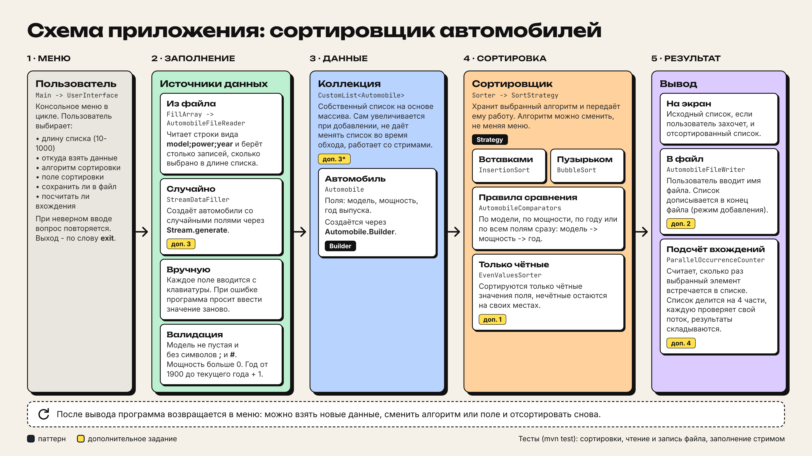
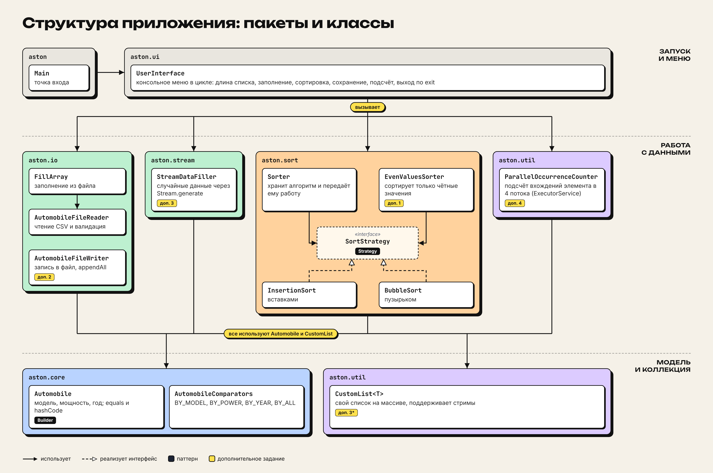

# ASTON Sorting Project

Консольное приложение для сортировки автомобилей.



## Возможности

- Заполнение списка тремя способами: из файла, случайными значениями (через стрим) или вручную с клавиатуры.
- Выбор длины списка: 10, 50, 100, 500 или 1000 элементов.
- Проверка данных из файла и при ручном вводе:
  - модель не пустая и не содержит `;` и `#`;
  - мощность больше 0;
  - год от 1900 до текущего года + 1.
- Две сортировки, написанные вручную: вставками и пузырьком.
- Сортировка по модели, по мощности, по году или по всем полям сразу (модель -> мощность -> год).
- Сортировка только чётных значений числового поля: нечётные остаются на своих местах.
- Сохранение отсортированного списка в файл в режиме добавления.
- Многопоточный подсчёт того, сколько раз выбранный элемент встречается в списке.
- Программа работает в цикле. Выход - по слову `exit`.

## Запуск

Требуются JDK 21 или новее и Maven.

1. Откройте проект в IntelliJ IDEA.
2. Запустите класс `aston.Main`.

Программу нужно запускать из корня проекта: 
файл с данными читается по пути `src/main/resources/automobiles-input.csv`.

Формат файла - одна строка на автомобиль, поля через `;`. 
Строки, которые начинаются с `#`, считаются комментариями:

```
# model;power;year
BMW X5;340;2022
Audi A4;190;2019
```

## Тесты

```
mvn test
```

Команда запускает все тесты проекта: сортировки, чтение и запись файла, заполнение через стрим. 
Тесты сортировки написаны вручную, их можно запустить и отдельно через класс `aston.sort.AllSortTests`.

## Структура



## Паттерны

- **Strategy.** Интерфейс `SortStrategy` реализуют классы `InsertionSort` и `BubbleSort`. 
Класс `Sorter` хранит выбранный алгоритм и передаёт ему работу. 
`EvenValuesSorter` тоже получает алгоритм как стратегию.
- **Builder.** Объект `Automobile` создаётся через `Automobile.Builder`.

## Дополнительные задания

| №  | Задание                                                     | Где реализовано                  |
|----|-------------------------------------------------------------|----------------------------------|
| 1  | Сортировка только чётных значений числового поля            | `EvenValuesSorter`               |
| 2  | Запись отсортированной коллекции в файл в режиме добавления | `AutomobileFileWriter.appendAll` |
| 3  | Заполнение коллекции через стримы                           | `StreamDataFiller`               |
| 3* | Собственная коллекция                                       | `CustomList`                     |
| 4  | Многопоточный подсчёт вхождений элемента                    | `ParallelOccurrenceCounter`      |

## Команда

### Шафиева Алия

- Каркас проекта: `Main`, `Automobile`, `CustomList`.
- `Automobile`: поля, `Automobile.Builder`, `toString`, `equals` / `hashCode`.
- `CustomList<T>` (доп. 3*): свой список на массиве с автоматическим расширением, защита от 
изменения во время обхода (`modCount`), `remove`, `contains`, `isEmpty`, `clear`, поддержка 
стримов через `spliterator()`.
- `StreamDataFiller` (доп. 3): заполнение случайными данными через `Stream.generate`.
- Тест: `StreamDataFillerTest`.

### Шиле Андрей

- `AutomobileComparators`: сортировка по модели, мощности, году и по всем полям сразу.
- Паттерн Strategy: интерфейс `SortStrategy` и контекст `Sorter`.
- Алгоритмы: `InsertionSort` (вставками), `BubbleSort` (пузырьком).
- `EvenValuesSorter` (доп. 1): сортировка только чётных значений числового поля.
- Правки в `UserInterface`: пункт «все поля», вывод списка после сортировки, запись в файл 
в режиме добавления (`appendAll`).
- Тесты: `SortStrategyTest`, `EvenValuesSorterTest`, `SortTestHelper`, `AllSortTests`, `SortTestsTest`.

### Шустер Алексей

- `AutomobileFileReader`: чтение CSV, разбор строк, пропуск комментариев и пустых строк.
- `AutomobileFileWriter` (доп. 2): запись в файл (`writeAll`) и дозапись в конец (`appendAll`).
- Файл с данными `automobiles-input.csv`.
- Тесты: `AutomobileFileReaderTest`, `AutomobileFileWriterTest`.

### Остряков Дмитрий

- `UserInterface`: консольное меню в цикле - длина списка, способ заполнения, сортировка, 
сохранение в файл, подсчёт вхождений, выход по `exit`.
- Валидация: ручной ввод в `UserInterface` и данные файла в `AutomobileFileReader` (модель, мощность, год).
- `FillArray`: заполнение из файла с учётом выбранной длины.

### Финенко Денис

- `ParallelOccurrenceCounter` (доп. 4): многопоточный подсчёт вхождений 
элемента - список делится на части, каждую считает свой поток (`ExecutorService`, `Callable`, `Future`),
результаты складываются.
